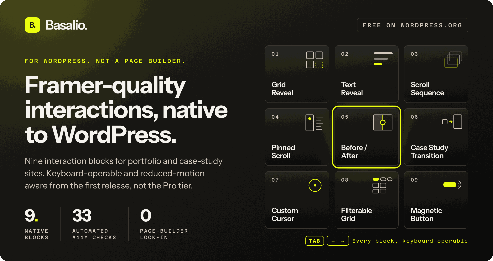

<a href="https://basalio.com">
  
</a>

<p>
  <a href="https://wordpress.org/plugins/basalio/"></a>
  
  
  
</p>

Portfolio sites live or die on how the work moves. Most designers get that motion by leaving WordPress for Framer, or by bolting a page builder onto a theme and copying the same GSAP snippet between client sites. Basalio puts it in the block editor instead.

Add a Basalio block the way you'd add a paragraph. Set it in the sidebar. Publish. There's no separate canvas, no shortcode, and nothing proprietary sitting in your content.

## The nine blocks

| | Block | What it does |
|---|---|---|
| 01 | **Grid Reveal** | Portfolio tiles reveal their captions on hover, keyboard focus, or tap. Never on autoplay. |
| 02 | **Text Reveal** | A staged entrance for headline, subhead, and button. CSS only, so the real text is in the DOM for screen readers from the start. |
| 03 | **Scroll Sequence** | A flipbook of frames driven by scroll position, with Previous and Next buttons so it works without scrolling at all. |
| 04 | **Pinned Scroll** | An image holds in place while its story scrolls past. Under reduced motion it becomes a plain stacked layout. |
| 05 | **Before / After** | A draggable comparison slider that's a real ARIA slider. Arrow keys move the divider. |
| 06 | **Case Study Transition** | A shared-element morph from grid tile to case-study hero, using cross-document View Transitions with a silent fallback. |
| 07 | **Custom Cursor** | A cursor accent for one bounded region. Off on touch, off under reduced motion, and it never covers what you click. |
| 08 | **Filterable Grid** | Visitors filter work by discipline with real buttons, and the result count is announced to screen readers. |
| 09 | **Magnetic Button** | A call to action that leans toward the pointer and stays static, fully operable, for keyboard and reduced-motion users. |

See every block running live at [basalio.com/blocks](https://basalio.com/blocks).

## Accessibility is the floor

Every block ships keyboard-operable and reduced-motion aware in the free version. That isn't a Pro feature, and it isn't a promise on a roadmap.

Version 0.5.1 came out of a full WCAG 2.2 audit of every block. The audit found real defects, like a Scroll Sequence that interrupted screen readers on every frame and a linked grid item with no accessible name. All of it got fixed, and an automated suite of 33 checks now runs against real rendered output so those bugs stay gone. In 0.6.0 the lightbox was rebuilt on the native `<dialog>` element, which gives you the browser's own focus trap and Escape-to-close instead of a hand-rolled imitation.

If a visitor flips their reduce-motion setting mid-session, the motion blocks respond right away. No reload.

## Light by design

The shared script loads only on pages that contain a Basalio block. Pages without one load nothing extra. There's no jQuery and no runtime framework, and no global stylesheet fighting your theme.

Uninstall it and your content degrades to static, semantic markup. Grids stay grids. Text stays text.

## Install

From your dashboard, go to **Plugins → Add New** and search for "Basalio." Or with WP-CLI:

```bash
wp plugin install basalio --activate
```

Then open any page in the block editor and add a block whose name starts with "Basalio." There's nothing to configure globally, because each block carries its own settings.

Works with block themes and classic themes that support the block editor. Requires WordPress 6.3+ and PHP 7.4+.

## Pro

The nine blocks stay free under GPL-2.0-or-later, with no locked blocks, no watermarks, and no site limits. Pro adds a control center in the editor sidebar for live-tuning every block, plus the Hacks vault. Founder licenses are one payment for unlimited sites. Details at [basalio.com/pricing](https://basalio.com/pricing).

## Links

[Website](https://basalio.com) · [WordPress.org](https://wordpress.org/plugins/basalio/) · [Changelog](https://wordpress.org/plugins/basalio/#developers) · [Support](https://wordpress.org/support/plugin/basalio/) · [X @getbasalio](https://x.com/getbasalio)

---

<sub>Built by <a href="https://chrowmdesigns.com">ChrowmDesigns</a>, a UX strategy studio that's been designing for the web since 1999.</sub>
